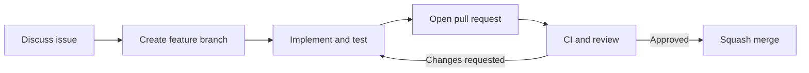

# Contributing to Nodex

Thanks for helping improve Nodex. This project teaches graph data structures and traversal algorithms through a small, offline Python console network simulator. Contributions should make the project **clearer, more reliable, easier to learn from, or more capable** without misrepresenting it as real networking software.

## What can be improved?

| Area | Possible contributions |
| --- | --- |
| **Learning experience** | Step-by-step BFS/DFS traces, clearer matrix explanations, accessible console prompts |
| **Graph capabilities** | Optional graph import/export, improved edge-case handling, alternative graph representations for comparison |
| **Testing** | More device-removal, disconnected-network, capacity, and invalid-input tests |
| **User experience** | Better terminal formatting, clearer help menus, optional interactive tutorials |
| **Documentation** | Beginner-friendly examples, diagrams, accessibility improvements and translations |

These are **ideas, not existing features**. Propose changes that increase the scope (such as persistence, more than 10 devices, or new dependencies) in an issue before implementing them.

## Development workflow

1. Check [existing issues](https://github.com/Kanechiii/nodex/issues) and [pull requests](https://github.com/Kanechiii/nodex/pulls) to avoid duplicate work. Open an issue explaining the problem and the proposed improvement for anything nontrivial.
2. Fork Nodex or create a working branch with a descriptive name such as `feature/bfs-trace`, `fix/device-removal` or `docs/clearer-menu`.
3. Clone your fork, make a small focused change, and keep the code understandable for beginning Python students.
4. Add or update tests and documentation for any behavior change. Include examples of success and failure cases.
5. Run the checks below. Push your branch and open a pull request targeting `main`. Explain what changed, how it was tested, and which issue it addresses.
6. Address review feedback and wait for the required checks and approval before merging. Prefer **squash and merge** to maintain a readable commit history.



## Set up and test

Requires Python 3.11 or later; the app uses the Python standard library.

```bash
git clone https://github.com/Kanechiii/nodex.git
cd nodex
```

Run the app using `py main.py` on Windows or `python3 main.py` on macOS/Linux.

Use `py` on Windows for these test commands (substitute `python3` on macOS/Linux):

```powershell
py -m unittest discover -s tests -p "test_*.py" -v
py -m unittest discover -s tests -p "*_check.py" -v
py scripts/security_audit.py
py scripts/history_privacy_audit.py
```

The history audit requires a **complete Git clone**, not a ZIP download or shallow checkout. The [CI workflow](https://github.com/Kanechiii/nodex/actions/workflows/security.yml) runs checks on Python 3.11 and 3.13.

## Implementation guidelines

- Keep **device IDs distinct from array indexes**; removing a device can change indexes.
- Maintain the **symmetric adjacency matrix** for every undirected connection, and respect device port capacities.
- Preserve the current manual BFS queue and recursive DFS, including visited arrays and deterministic ascending-index traversal, unless a proposed feature explicitly compares a different implementation.
- Handle invalid inputs, missing devices, empty networks, duplicate IDs, full capacity, and disconnected components.
- Document the **time and auxiliary-space complexity** of changed algorithms. Add unit tests that cover the new behavior and regressions.
- Prefer small, readable Python methods and descriptive names. Avoid third-party dependencies unless discussed and justified.
- Keep everything offline by default. Do not add real network scanning, credential collection, or device configuration without a separate security/design review.

## Pull-request checklist

- [ ] The change addresses a documented issue or a clearly described improvement.
- [ ] Tests pass locally and cover important edge cases.
- [ ] The README or [workflow guide](docs/WORKFLOWS.md) reflects changed menu behavior.
- [ ] No secrets, private information, compiled files, or unrelated changes are committed.
- [ ] The pull request explains the approach, testing, and relevant complexity changes.

## Security, licensing and conduct

Report vulnerabilities **privately** using [SECURITY.md](SECURITY.md); avoid exposing credentials or exploit details in public issues. By submitting a contribution, you agree that the submitted code can be distributed under the repository's [MIT License](LICENSE) and confirm you have the right to contribute it.

Be constructive and respectful when reviewing work or asking questions. Nodex is a learning project, so explanations and reproducible examples matter as much as code.
