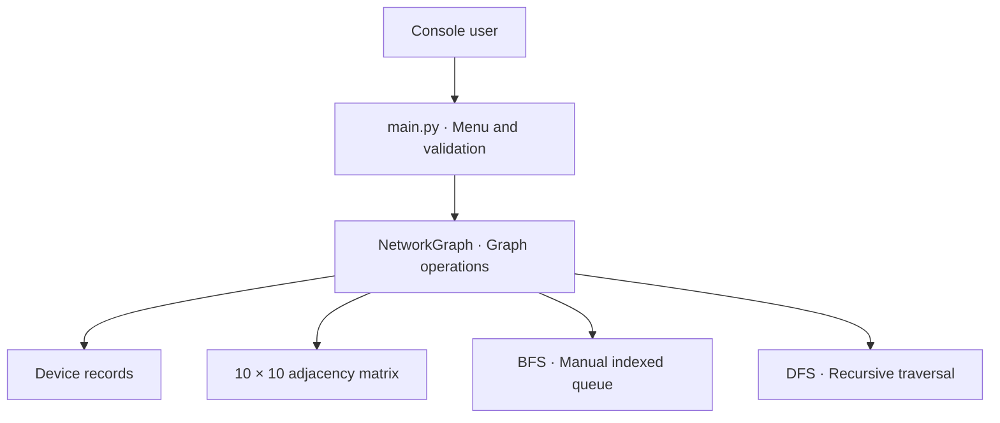
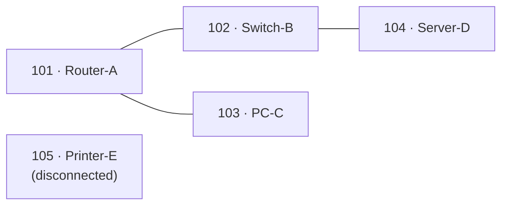
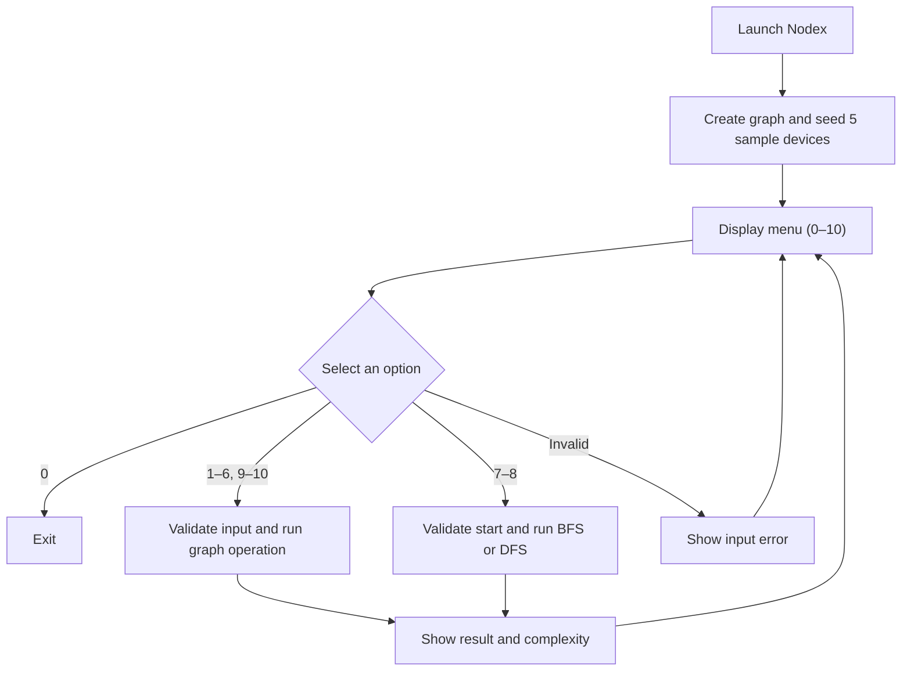

<div align="center">
  

  <h1>Nodex</h1>
  <p>An offline Python console simulator for device connectivity, breadth-first search (BFS), and depth-first search (DFS).</p>

  <p>
    <a href="https://github.com/Kanechiii/nodex/actions/workflows/security.yml"></a>
    <a href="https://github.com/Kanechiii/nodex/releases"></a>
    <a href="LICENSE"></a>
    
  </p>
</div>

## Quick start

**Requirements:** Python 3.11 or newer. No third-party dependencies.

**Windows (VS Code / PowerShell)**

```powershell
git clone https://github.com/Kanechiii/nodex.git
cd nodex
py main.py
```

<details>
<summary><strong>macOS / Linux commands</strong></summary>

```bash
git clone https://github.com/Kanechiii/nodex.git
cd nodex
python3 main.py
```

</details>

The console starts with **five sample devices** and three links. Select a number from **1–10** to perform an operation; enter **0** to exit. All changes are in memory and reset on restart.

## How it works

<details open>
<summary><strong>Architecture and sample network</strong> — click to collapse</summary>

### Architecture



Every device is a **vertex**; each bidirectional link is an **edge**. The matrix stores **1** for a direct connection and **0** otherwise. No graph library, built-in queue class, or visited set is used.

### Default network



Starting at **101** without disconnected components:

| Traversal | Visit order |
| --- | --- |
| **BFS** | `101 → 102 → 103 → 104` |
| **DFS** | `101 → 102 → 104 → 103` |

Enable **Include disconnected components** to visit the isolated printer, too.

</details>

## Console features

<details>
<summary><strong>View all 10 operations</strong></summary>

| # | Operation | # | Operation |
| --- | --- | --- | --- |
| 1 | Add device | 6 | Display network topology |
| 2 | Remove device | 7 | Breadth-first search (BFS) |
| 3 | Connect devices | 8 | Depth-first search (DFS) |
| 4 | Disconnect devices | 9 | Count devices |
| 5 | Search device | 10 | Check direct link |

Nodex validates input, rejects duplicate device IDs and self-links, checks available ports, and displays time and auxiliary-space complexity after each operation.

</details>

<details>
<summary><strong>Algorithms and complexity</strong></summary>

For **V** active devices (up to 10):

| Operation | Time | Auxiliary space |
| --- | --- | --- |
| Count devices | O(1) | O(1) |
| Add, search, connect, disconnect, direct-link check | O(V) | O(1) |
| Remove device, display topology | O(V²) | O(1) |
| BFS, DFS | O(V²) | O(V) |

BFS uses an indexed array queue; DFS uses recursion. Both use visited arrays and traverse neighbors by ascending index. The graph's fixed 10 × 10 matrix requires O(10²) storage.

</details>

<details>
<summary><strong>Source-code layout</strong></summary>

```text
nodex/
├── main.py                    Console menu and input validation
├── models/device.py           Device record
├── structures/graph.py        Undirected adjacency matrix
├── algorithms/bfs.py          BFS with manually indexed queue
├── algorithms/dfs.py          Recursive DFS
├── tests/                     Console, graph, traversal, security tests
├── scripts/                   Security and history audit tools
├── SECURITY.md                Responsible disclosure policy
└── DEFENSE_NOTES.md           Algorithm explanations
```

</details>

## Application workflow

Nodex repeats the same cycle until you select **0 — Exit**. The console handles input and messages, while `NetworkGraph` manages devices and the adjacency matrix. Every valid menu operation finishes by displaying its time and auxiliary-space complexity.



For detailed decision points and diagrams, see **[workflows for all 10 menu operations](docs/WORKFLOWS.md)**.

## Menu operation workflows

Expand an option to see how it works. Each has a separate [decision-flow diagram](docs/WORKFLOWS.md) with validation and error paths.

<details>
<summary><strong>1 — Add device</strong></summary>

Check capacity → validate unique ID and device details → insert record; report full capacity or duplicate IDs.

[View full flowchart](docs/WORKFLOWS.md#1-add-device)

</details>

<details>
<summary><strong>2 — Remove device</strong></summary>

Find ID → remove record → shift matrix rows and columns → clear unused slot; report missing IDs.

[View full flowchart](docs/WORKFLOWS.md#2-remove-device)

</details>

<details>
<summary><strong>3 — Connect devices</strong></summary>

Read IDs → verify devices, distinct endpoints, no existing link and free ports → set both matrix cells to 1.

[View full flowchart](docs/WORKFLOWS.md#3-connect-devices)

</details>

<details>
<summary><strong>4 — Disconnect devices</strong></summary>

Read IDs → validate devices and existing link → set both matrix cells to 0.

[View full flowchart](docs/WORKFLOWS.md#4-disconnect-devices)

</details>

<details>
<summary><strong>5 — Search device</strong></summary>

Find device by ID → display record fields or a not-found message.

[View full flowchart](docs/WORKFLOWS.md#5-search-device)

</details>

<details>
<summary><strong>6 — Display network topology</strong></summary>

Print devices → show indexed adjacency matrix and the per-device adjacency list; handle empty graphs.

[View full flowchart](docs/WORKFLOWS.md#6-display-network-topology)

</details>

<details>
<summary><strong>7 — Breadth-first search (BFS)</strong></summary>

Validate start and choice to include disconnected components → traverse by indexed queue → display visit order.

[View full flowchart](docs/WORKFLOWS.md#7-breadth-first-search-bfs)

</details>

<details>
<summary><strong>8 — Depth-first search (DFS)</strong></summary>

Validate start and choice to include disconnected components → traverse recursively → display visit order.

[View full flowchart](docs/WORKFLOWS.md#8-depth-first-search-dfs)

</details>

<details>
<summary><strong>9 — Count devices</strong></summary>

Read the active device counter → display active devices out of 10.

[View full flowchart](docs/WORKFLOWS.md#9-count-devices)

</details>

<details>
<summary><strong>10 — Check direct link</strong></summary>

Read IDs → reject missing or identical IDs → inspect matrix edge → report linked or unlinked.

[View full flowchart](docs/WORKFLOWS.md#10-check-direct-link)

</details>

## Tests and security

<details>
<summary><strong>Run tests and security checks</strong></summary>

From the repository root, on Windows:

```powershell
py -m unittest discover -s tests -p "test_*.py" -v
py -m unittest discover -s tests -p "*_check.py" -v
```

For the security and Git history audits, use a **full Git clone**:

```powershell
py scripts/security_audit.py
py scripts/history_privacy_audit.py
```

On macOS/Linux, replace `py` with `python3`. GitHub Actions checks Python 3.11 and 3.13, unit tests, source code, and reachable Git history. See the [security policy](SECURITY.md) for responsible reporting.

</details>

## Contributing

Contributions are welcome—especially improvements to graph operations, learning features, accessibility, and automated testing. Please open an issue to discuss larger changes before implementing them, then submit a focused pull request.

Start with the **[contribution guide](CONTRIBUTING.md)** for the development workflow, test commands, and suggested enhancements. Preserve the educational purpose: keep the console usable offline and explain any new data structures or algorithms.

## License and contributors

Released under the **[MIT License](LICENSE)**. Copyright © 2026 **[Kenneth Gabriel Alido](https://github.com/Kanechiii)** and **[Mark Ryan Songalia](https://github.com/gyryan)**.

## Disclaimer

Nodex is an **educational graph-based network simulator**, not a real network management, monitoring, security scanning, or device configuration tool. Its connections and device records are simulated in memory, and all changes reset when the program closes. It does not emulate packet forwarding, routing protocols, VLANs, STP, or physical network behavior, and it is **not a replacement for Cisco Packet Tracer**. Use it to learn fundamental graph concepts, not to make decisions about operational networks.

