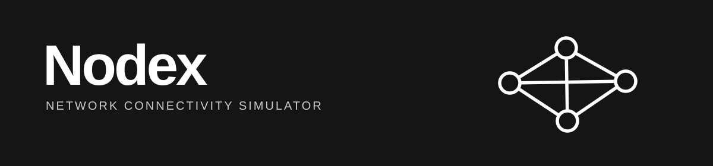
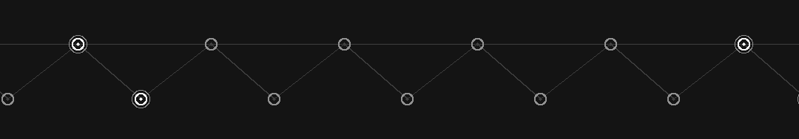
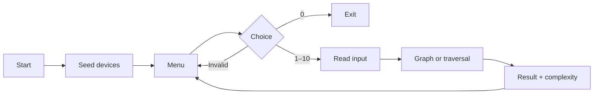

<div align="center">
  
  
  <p>
    <a href="https://github.com/Kanechiii/nodex/actions/workflows/security.yml"></a>
    <a href="LICENSE"></a>
  </p>
</div>

## 🎓 About Nodex

**Nodex is a final project for the Data Structures and Algorithms course.** We built it to demonstrate how a **graph**, a non-linear data structure, can model a practical problem: representing devices and their connections in a small network.

Each device is a **vertex** and each direct connection is an **edge**. A manually implemented **10 × 10 adjacency matrix** records those links, while **breadth-first search (BFS)** and **depth-first search (DFS)** show different ways to explore them. The project connects classroom concepts to a familiar networking scenario; it does **not** replace a networking simulator.

Nodex is a Python console application. It runs offline, uses no external packages, and keeps all changes in memory until exit.

The sample starts with five devices, three links, and an isolated printer. From device `101`, BFS visits `101 → 102 → 103 → 104`; DFS visits `101 → 102 → 104 → 103`. Select **Include disconnected components** to visit device `105` too.

## Run Nodex

Requires **Python 3.11+** and Git. In VS Code or another terminal:

**Windows / PowerShell**

```powershell
git clone https://github.com/Kanechiii/nodex.git
cd nodex
py main.py
```

**macOS / Linux**

```bash
git clone https://github.com/Kanechiii/nodex.git
cd nodex
python3 main.py
```

Enter an option from **1–10**, or **0** to exit. Invalid input is handled by the console.

## What the menu does

Each operation links to its full decision-flow diagram. These are the **implemented** options, not planned features.

| Option | Function | Option | Function |
| :---: | --- | :---: | --- |
| 1 | [Add device](docs/WORKFLOWS.md#1-add-device) | 6 | [Display topology](docs/WORKFLOWS.md#6-display-network-topology) |
| 2 | [Remove device](docs/WORKFLOWS.md#2-remove-device) | 7 | [BFS](docs/WORKFLOWS.md#7-breadth-first-search-bfs) |
| 3 | [Connect devices](docs/WORKFLOWS.md#3-connect-devices) | 8 | [DFS](docs/WORKFLOWS.md#8-depth-first-search-dfs) |
| 4 | [Disconnect devices](docs/WORKFLOWS.md#4-disconnect-devices) | 9 | [Count devices](docs/WORKFLOWS.md#9-count-devices) |
| 5 | [Search device](docs/WORKFLOWS.md#5-search-device) | 10 | [Check direct link](docs/WORKFLOWS.md#10-check-direct-link) |

### Application flow



The console layer reads and validates input; [`NetworkGraph`](structures/graph.py) stores records and edges. BFS uses an indexed queue and a visited array; DFS uses recursion and a visited array. Traversals check neighbors in ascending array-index order.

See the [complete workflow guide](docs/WORKFLOWS.md) for every decision, error path and matrix update in options 1–10.

## Data structure and complexity

| Concept | Implementation |
| --- | --- |
| Graph | Undirected; maximum 10 devices |
| Storage | Fixed adjacency matrix: `1` = linked, `0` = unlinked |
| Devices | Unique IDs, hostnames, types and port limits |
| BFS | Manually indexed queue, O(V²) time |
| DFS | Recursive calls, O(V²) time |
| Extra traversal space | O(V) for visited state and queue or call stack |

Here **V** is the active device count (at most 10). Both traversals take O(V²) time because they scan adjacency-matrix rows, including zero entries. There is no database, live network discovery or packet simulation.

Source files: [console](main.py) · [graph](structures/graph.py) · [device](models/device.py) · [BFS](algorithms/bfs.py) · [DFS](algorithms/dfs.py)

## Tests

Run the standard tests from the repository root:

```powershell
py -m unittest discover -s tests -p "test_*.py" -v
py -m unittest discover -s tests -p "*_check.py" -v
```

For macOS/Linux, replace `py` with `python3`. GitHub Actions runs these tests on Python 3.11 and 3.13. The additional history checks and reporting policy are described in [SECURITY.md](SECURITY.md).

## 🤝 Contributing

Bug reports, clearer documentation and code improvements are welcome. Read [CONTRIBUTING.md](CONTRIBUTING.md) before opening a pull request; changes to functionality should include tests and an explanation of the underlying algorithm.

## License and authors

Licensed under [MIT](LICENSE). Created by [Kenneth Gabriel Alido](https://github.com/Kanechiii) and [Mark Ryan Songalia](https://github.com/gyryan).

## Disclaimer

Nodex is **only an educational graph simulation** developed to meet a Data Structures and Algorithms final project requirement. It illustrates network connectivity and traversal; it does not simulate real traffic, configuration or advanced protocols such as VLANs and STP. It is **not a substitute for Cisco Packet Tracer or any other networking simulator**.
