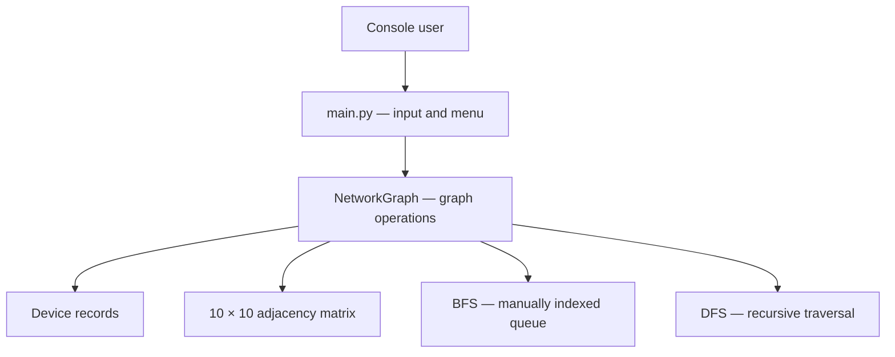
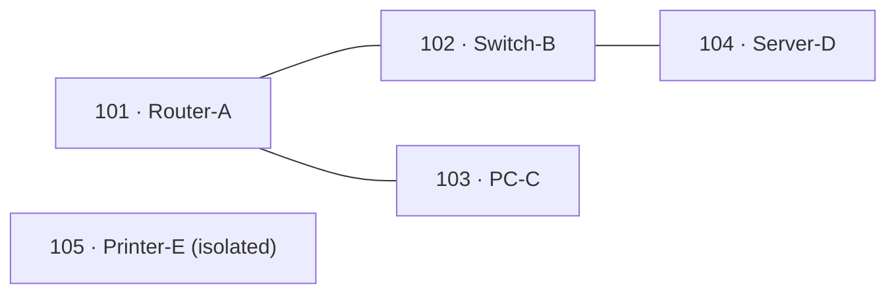

# Nodex

[](https://github.com/Kanechiii/nodex/actions/workflows/security.yml)

**A lightweight, terminal-based network connectivity simulator built to demonstrate graph data structures, BFS, and DFS in Python.**

Nodex models up to **10 devices** with an undirected adjacency matrix. Its graph, BFS queue, and DFS traversal are implemented manually rather than using graph or queue libraries. It runs entirely offline, with **no third-party dependencies**.

## Quick start

**Requirements:** Python 3.11 or newer (CI tests Python 3.11 and 3.13). Run commands from the repository root.

**Windows / VS Code PowerShell**

```powershell
git clone https://github.com/Kanechiii/nodex.git
cd nodex
py main.py
```

**macOS / Linux**

```bash
git clone https://github.com/Kanechiii/nodex.git
cd nodex
python3 main.py
```

The menu accepts **0 to exit** and **1–10** for network operations. Each operation displays its time and auxiliary-space complexity.

## How Nodex works



Every device has a unique ID, hostname, type, and port capacity. Connections are bidirectional; the adjacency matrix stores **1** for a link and **0** otherwise. BFS and DFS both use a visited array and explore neighbors in ascending device-index order.

### Default example network

Nodex starts with five devices and three links. The printer is intentionally isolated to demonstrate disconnected components.



For example, starting at device **101** with disconnected components excluded:

- **BFS:** `101 → 102 → 103 → 104`
- **DFS:** `101 → 102 → 104 → 103`

Choose **Include disconnected components** to visit device 105 as well.

## Features

| Network management | Exploration |
| --- | --- |
| Add, remove, and search for devices | Display devices, matrix, and adjacency list |
| Connect and disconnect devices | Breadth-first search (BFS) |
| Enforce port capacity and reject invalid links | Depth-first search (DFS) |
| Count devices and check direct links | Traverse disconnected components |

The console validates user input, duplicate IDs, device limits, and invalid connections. Changes are kept **in memory only** and reset when the program exits.

## Project structure

| Path | Responsibility |
| --- | --- |
| [`main.py`](main.py) | Console menu and input validation |
| [`models/device.py`](models/device.py) | Device records |
| [`structures/graph.py`](structures/graph.py) | Custom adjacency matrix and graph operations |
| [`algorithms/bfs.py`](algorithms/bfs.py) | BFS with indexed queue |
| [`algorithms/dfs.py`](algorithms/dfs.py) | Recursive DFS |
| [`tests/`](tests) | Graph, menu, traversal, and security tests |
| [`scripts/`](scripts) | Security and history audits |

## Run the tests

On Windows, from the repository root:

```powershell
py -m unittest discover -s tests -p "test_*.py" -v
py -m unittest discover -s tests -p "*_check.py" -v
```

On macOS/Linux, use `python3` instead of `py`. The same suites run in [GitHub Actions](https://github.com/Kanechiii/nodex/actions/workflows/security.yml).

## Complexity at a glance

Let **V** be the number of active devices (maximum 10).

| Operation | Time | Auxiliary space |
| --- | --- | --- |
| Count devices | O(1) | O(1) |
| Add, search, connect, disconnect, direct-link check | O(V) | O(1) |
| Remove device or display topology | O(V²) | O(1) |
| BFS and DFS | O(V²) | O(V) |

The fixed 10 × 10 matrix stores **O(10²)** entries; traversal return lists use another O(V) of output space. Because the graph uses a matrix, traversal is O(V²), not O(V + E).

## Security and project notes

- [Security policy and responsible reporting](SECURITY.md)
- [Algorithm explanations for project defense](DEFENSE_NOTES.md)
- **Educational simulation only:** Nodex does not discover, scan, or configure real networks.
- **Licensing:** No license is currently specified. Public visibility does not itself grant permission to reuse or redistribute the code.
