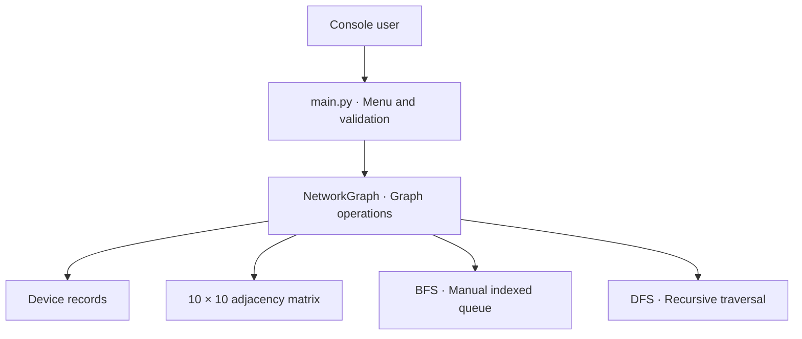
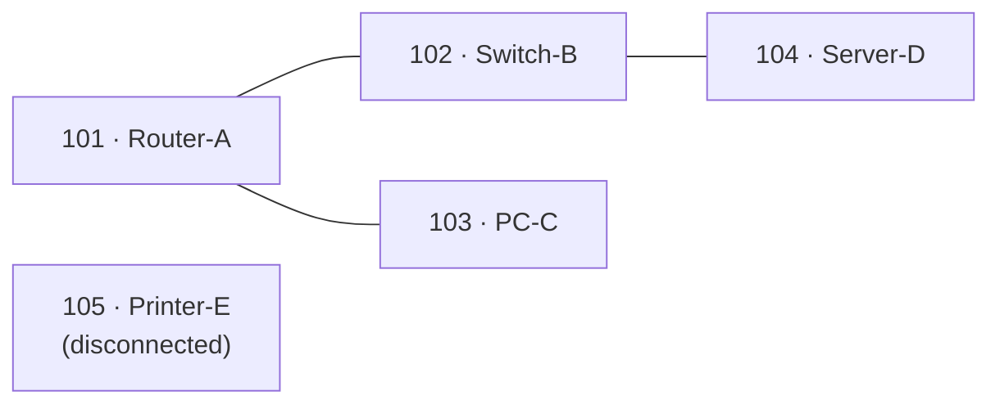

<div align="center">
  

  <h1>Nodex</h1>
  <p><strong>Explore networks. Understand graphs.</strong></p>
  <p>An offline Python console simulator for device connectivity, breadth-first search (BFS), and depth-first search (DFS).</p>

  <p>
    <a href="https://github.com/Kanechiii/nodex/actions/workflows/security.yml"></a>
    <a href="https://github.com/Kanechiii/nodex/releases"></a>
    <a href="LICENSE"></a>
    
  </p>

  <p>
    <a href="#quick-start">Quick start</a> ·
    <a href="#how-it-works">How it works</a> ·
    <a href="#console-features">Console features</a> ·
    <a href="#tests-and-security">Tests</a> ·
    <a href="#license-and-contributors">License</a>
  </p>
</div>

## Quick start

**Requirements:** Python 3.11 or newer. No third-party dependencies.

**Windows (VS Code / PowerShell)**

```powershell
git clone https://github.com/Kanechiii/nodex.git
cd nodex
py main.py
```

<details>
<summary><strong>macOS / Linux commands</strong></summary>

```bash
git clone https://github.com/Kanechiii/nodex.git
cd nodex
python3 main.py
```

</details>

The console starts with **five sample devices** and three links. Select a number from **1–10** to perform an operation; enter **0** to exit. All changes are in memory and reset on restart.

## How it works

<details open>
<summary><strong>Architecture and sample network</strong> — click to collapse</summary>

### Architecture



Every device is a **vertex**; each bidirectional link is an **edge**. The matrix stores **1** for a direct connection and **0** otherwise. No graph library, built-in queue class, or visited set is used.

### Default network



Starting at **101** without disconnected components:

| Traversal | Visit order |
| --- | --- |
| **BFS** | `101 → 102 → 103 → 104` |
| **DFS** | `101 → 102 → 104 → 103` |

Enable **Include disconnected components** to visit the isolated printer, too.

</details>

## Console features

<details>
<summary><strong>View all 10 operations</strong></summary>

| # | Operation | # | Operation |
| --- | --- | --- | --- |
| 1 | Add device | 6 | Display network topology |
| 2 | Remove device | 7 | Breadth-first search (BFS) |
| 3 | Connect devices | 8 | Depth-first search (DFS) |
| 4 | Disconnect devices | 9 | Count devices |
| 5 | Search device | 10 | Check direct link |

Nodex validates input, rejects duplicate device IDs and self-links, checks available ports, and displays time and auxiliary-space complexity after each operation.

</details>

<details>
<summary><strong>Algorithms and complexity</strong></summary>

For **V** active devices (up to 10):

| Operation | Time | Auxiliary space |
| --- | --- | --- |
| Count devices | O(1) | O(1) |
| Add, search, connect, disconnect, direct-link check | O(V) | O(1) |
| Remove device, display topology | O(V²) | O(1) |
| BFS, DFS | O(V²) | O(V) |

BFS uses an indexed array queue; DFS uses recursion. Both use visited arrays and traverse neighbors by ascending index. The graph's fixed 10 × 10 matrix requires O(10²) storage.

</details>

<details>
<summary><strong>Source-code layout</strong></summary>

```text
nodex/
├── main.py                    Console menu and input validation
├── models/device.py           Device record
├── structures/graph.py        Undirected adjacency matrix
├── algorithms/bfs.py          BFS with manually indexed queue
├── algorithms/dfs.py          Recursive DFS
├── tests/                     Console, graph, traversal, security tests
├── scripts/                   Security and history audit tools
├── SECURITY.md                Responsible disclosure policy
└── DEFENSE_NOTES.md           Algorithm explanations
```

</details>

## Tests and security

<details>
<summary><strong>Run tests and security checks</strong></summary>

From the repository root, on Windows:

```powershell
py -m unittest discover -s tests -p "test_*.py" -v
py -m unittest discover -s tests -p "*_check.py" -v
```

For the security and Git history audits, use a **full Git clone**:

```powershell
py scripts/security_audit.py
py scripts/history_privacy_audit.py
```

On macOS/Linux, replace `py` with `python3`. GitHub Actions checks Python 3.11 and 3.13, unit tests, source code, and reachable Git history. See the [security policy](SECURITY.md) for responsible reporting.

</details>

## License and contributors

Released under the **[MIT License](LICENSE)**. Copyright © 2026 **[Kenneth Gabriel Alido](https://github.com/Kanechiii)** and **[Mark Ryan Songalia](https://github.com/gyryan)**.

Nodex is an **educational simulator**, not a tool for scanning, monitoring, or changing real networks.