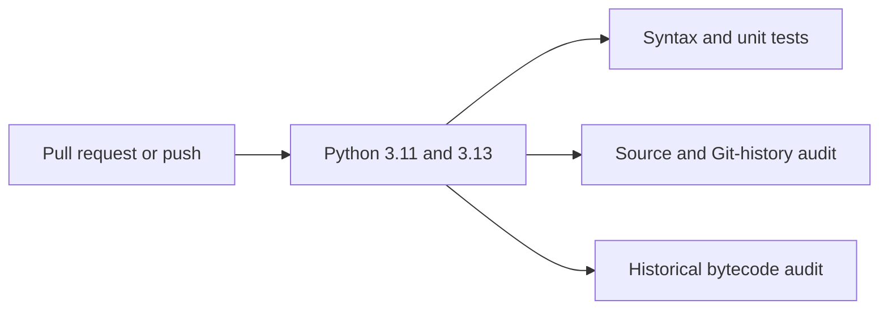

# Security Policy

Nodex is an **offline Python learning project**, not a production network monitor or security scanner. It uses no cloud credentials, third-party packages, or external services at runtime.

## Supported code

Security fixes and reports concern the current `main` branch. No separately maintained release series has been announced.

## Reporting a vulnerability

**Do not publish credentials, exploit details, or private information in a public GitHub issue.**

If GitHub's private vulnerability reporting is enabled, open the repository **Security** tab and choose **Report a vulnerability**. Otherwise, contact the repository maintainers through a trusted private channel before sharing sensitive details. Include the affected file, reproduction steps, and likely impact; remove any real secrets from the report.

## Built-in protections

- **Local-only operation:** device records and connections exist in memory and are discarded on exit.
- **Input validation:** the menu handles invalid numbers, missing devices, duplicate IDs, self-links, and exhausted ports.
- **Automated review:** the [Security and Python checks](.github/workflows/security.yml) workflow runs on pull requests and pushes to `main`. It uses read-only permissions and tests Python 3.11 and 3.13.



The audits detect selected secret signatures, risky Python calls, and possible sensitive strings in historical bytecode. **A passing scan is not proof that the repository is free of vulnerabilities or sensitive information.**

## Verify locally

Run these commands from a **full Git clone**, not a ZIP download or shallow clone, so the history checks can inspect reachable commits.

```powershell
py -m unittest discover -s tests -p "test_*.py" -v
py -m unittest discover -s tests -p "*_check.py" -v
py scripts/security_audit.py
py scripts/history_privacy_audit.py
```

Use `python3` instead of `py` on macOS/Linux.

## Historical data and responsible contributions

Git history can expose earlier author email addresses and previously committed files even after they are removed from `main`. Never commit passwords, API keys, private keys, real user records, or confidential files. If a secret is exposed, **revoke or rotate it first**; a later deletion or successful scan does not remove historical exposure.

Before merging changes, review the diff and required checks. The audit tools are read-only and intentionally avoid printing matched secret values.
