# Nodex — Menu Workflows

This guide follows the **actual Python console implementation** in [`main.py`](../main.py) and [`NetworkGraph`](../structures/graph.py). Nodex uses a **fixed-capacity, undirected 10-device adjacency matrix**, a manually indexed BFS queue and recursive DFS.

## Overall flow

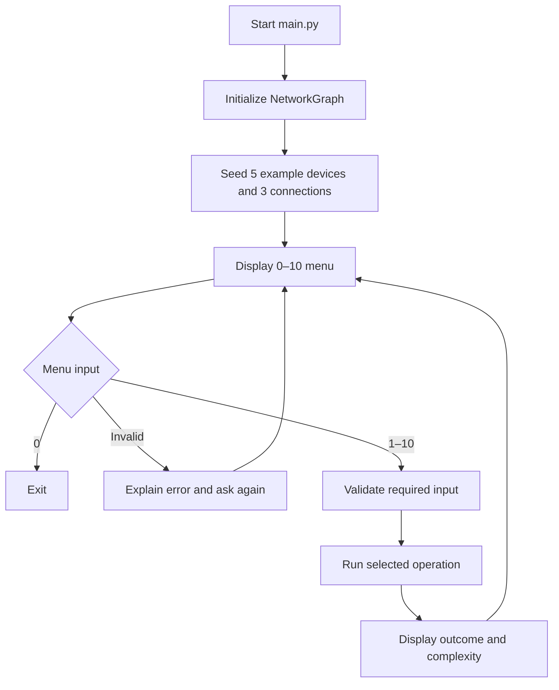

**Input rules:** The console retries invalid numbers and blank text fields. Device IDs and port counts must be non-negative integers. Unless an operation is skipped at the menu (e.g., invalid menu choice), it displays its time and auxiliary-space complexity after the attempt.

Each expandable section contains the operation's inputs, implementation flow, expected outcome, and validation paths.

### 1. Add device

<strong>View decision-flow diagram</strong>

**Inputs:** Device ID, hostname, device type, port capacity.

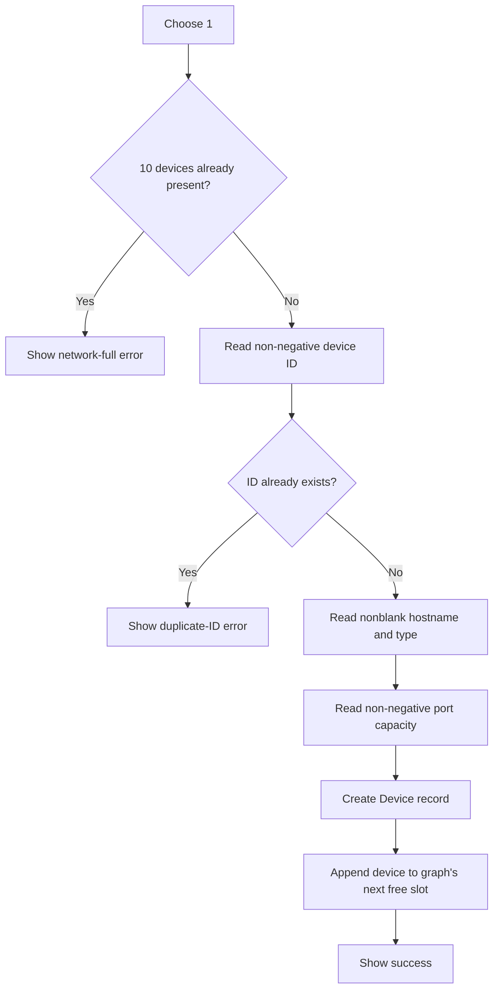

The graph stores the device in an active slot, preserving its unique ID. **Time O(V), auxiliary space O(1)**.

### 2. Remove device

<strong>View decision-flow diagram</strong>

**Input:** Device ID to remove.

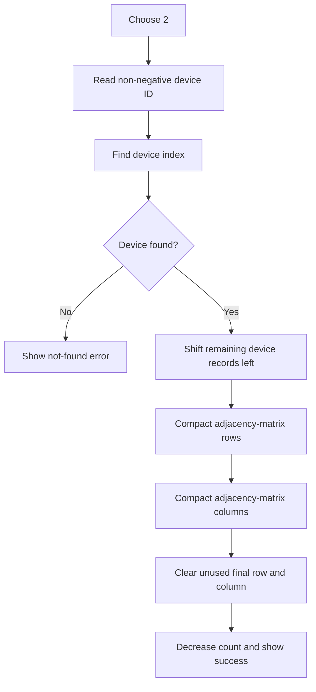

Removal also removes all links to the deleted device while preserving the other devices' IDs and connections. **Time O(V²), auxiliary space O(1)**.

### 3. Connect devices

<strong>View decision-flow diagram</strong>

**Inputs:** Two device IDs.

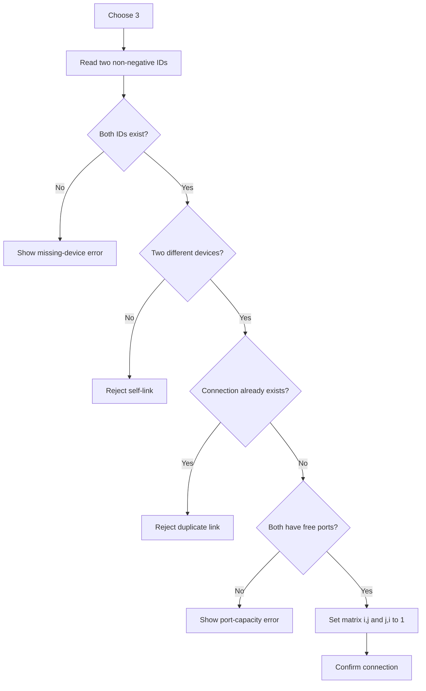

Each connection uses one port on each endpoint; connections are bidirectional. **Time O(V), auxiliary space O(1)**.

### 4. Disconnect devices

<strong>View decision-flow diagram</strong>

**Inputs:** Two device IDs.

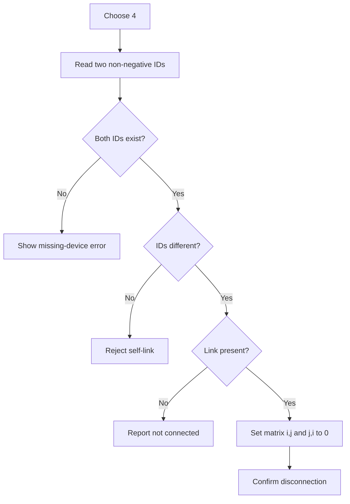

The devices remain in the graph; only their direct edge is removed. **Time O(V), auxiliary space O(1)**.

### 5. Search device

<strong>View decision-flow diagram</strong>

**Input:** Device ID.

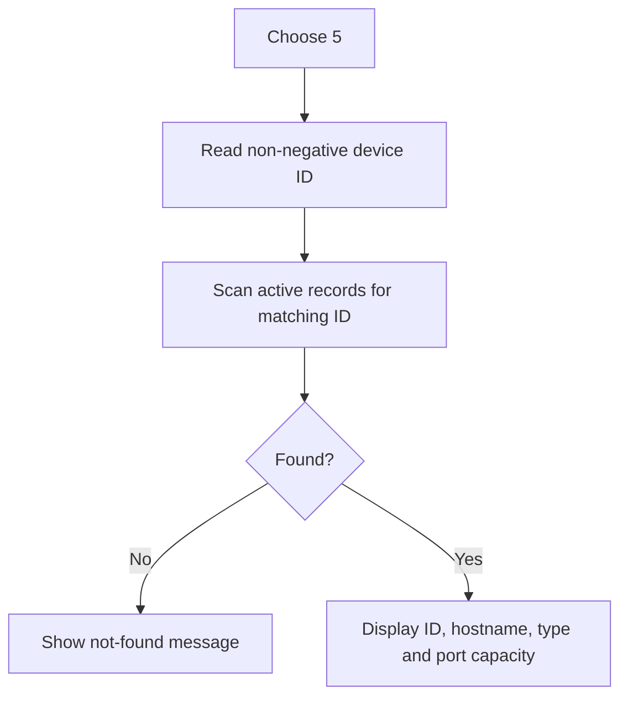

Search uses the device's **ID**, not its changing array index. **Time O(V), auxiliary space O(1)**.

### 6. Display network topology

<strong>View decision-flow diagram</strong>

**Input:** None.

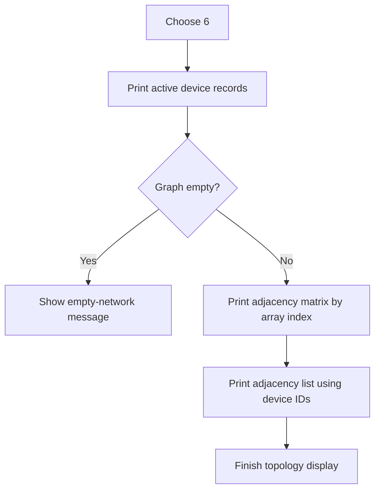

A **1** at position `[i][j]` means the indexed devices share a direct link; a **0** means they do not. The adjacency list shows neighboring **device IDs**, which are easier for learners to follow. **Time O(V²), auxiliary space O(1)**.

### 7. Breadth-first search (BFS)

<strong>View decision-flow diagram</strong>

**Inputs:** Start device ID and whether to include disconnected components.

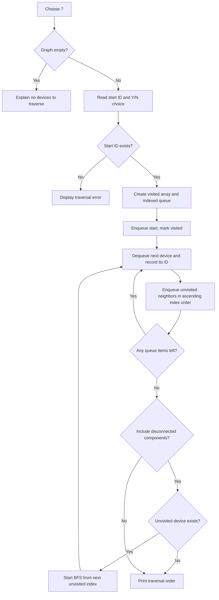

BFS explores nearer neighbors before deeper levels. The queue is a fixed-size Python list managed using explicit front/rear indexes. **Time O(V²), auxiliary space O(V)**.

### 8. Depth-first search (DFS)

<strong>View decision-flow diagram</strong>

**Inputs:** Start device ID and whether to include disconnected components.

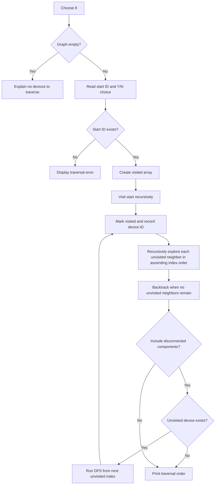

DFS follows each branch as far as possible before backtracking. It uses recursion and a visited array, not a built-in stack or visited set. **Time O(V²), auxiliary space O(V)**.

### 9. Count devices

<strong>View decision-flow diagram</strong>

**Input:** None.

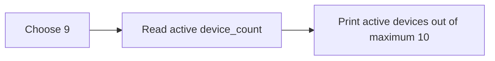

Nodex maintains this count as devices are added and removed, so no scan is needed. **Time O(1), auxiliary space O(1)**.

### 10. Check direct link

<strong>View decision-flow diagram</strong>

**Inputs:** Two device IDs.

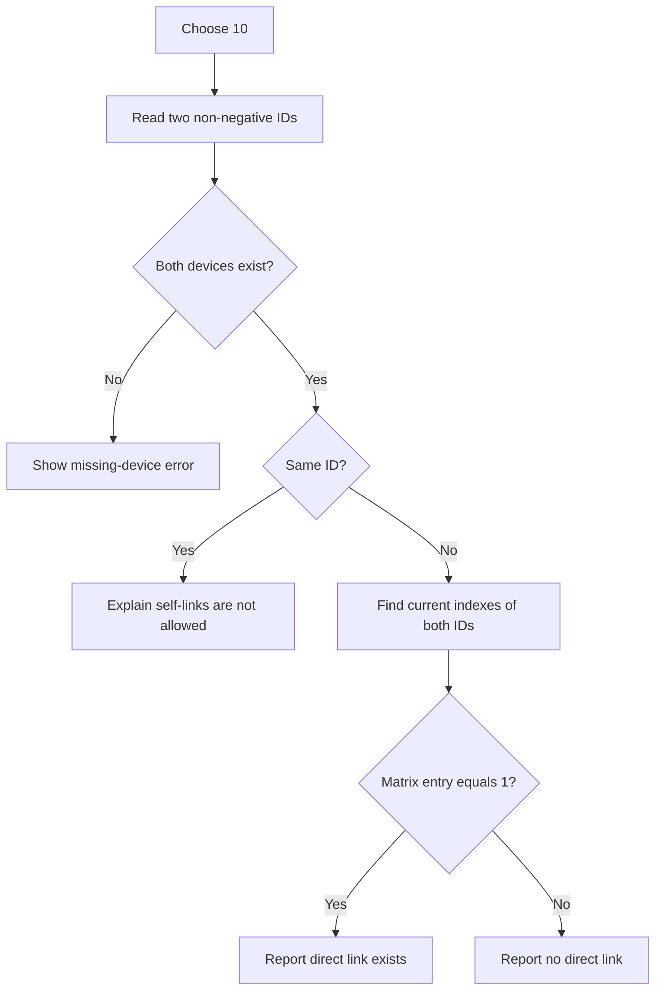

This checks a **single direct connection**, not whether two devices can reach one another through intermediate devices. Looking up IDs costs O(V), so **time O(V), auxiliary space O(1)**.

## Traversal example

The sample graph has links `101–102`, `101–103` and `102–104`; device `105` is isolated. With start ID `101`, both algorithms visit the connected component; enabling disconnected components also visits `105`. The exact order is deterministic because neighbors are examined by increasing array index.

[Back to the README](../README.md) · [Contributing](../CONTRIBUTING.md) · [Algorithm defense notes](../DEFENSE_NOTES.md)
