# Nodex workflows

These diagrams document the **current console behavior** in [`main.py`](../main.py), [`graph.py`](../structures/graph.py), [`bfs.py`](../algorithms/bfs.py) and [`dfs.py`](../algorithms/dfs.py). Each menu operation is shown separately rather than combining steps.

**Shared input handling:** Numeric prompts repeat until a whole number at least 0 is entered. Text prompts repeat until nonblank. BFS/DFS's Y/N prompt repeats until a valid answer. For any selected operation 1–10, the console prints the operation's **time and auxiliary-space complexity** after completion or an application-level error. Only invalid menu selections and option 0 skip that line.

## Main loop

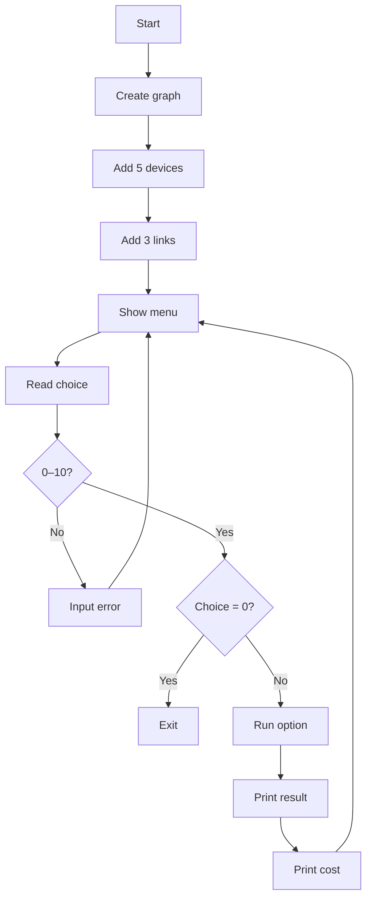

## 1. Add device

**Input:** ID, hostname, type, port capacity.

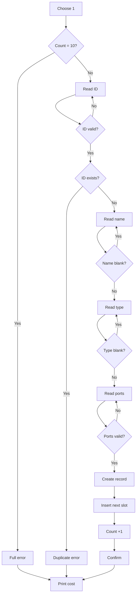

The graph checks capacity and uniqueness before insertion. No adjacency-matrix edge is created automatically. **Time O(V), space O(1)**.

## 2. Remove device

**Input:** ID.

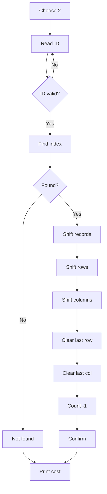

Removing a device deletes all of its links. Remaining records shift left; their IDs stay unchanged while their matrix indexes may change. **Time O(V²), space O(1)**.

## 3. Connect devices

**Input:** Two IDs.

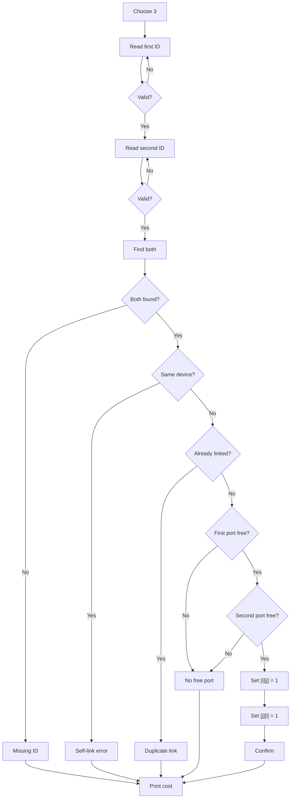

Each undirected link uses one port on each endpoint. The matrix is updated **symmetrically** only when all checks pass. **Time O(V), space O(1)**.

## 4. Disconnect devices

**Input:** Two IDs.

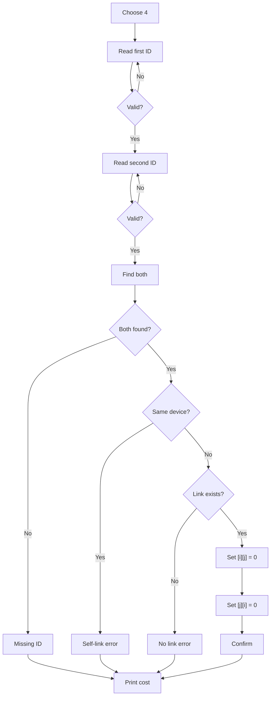

Only the edge is removed; both device records remain. **Time O(V), space O(1)**.

## 5. Search device

**Input:** ID.

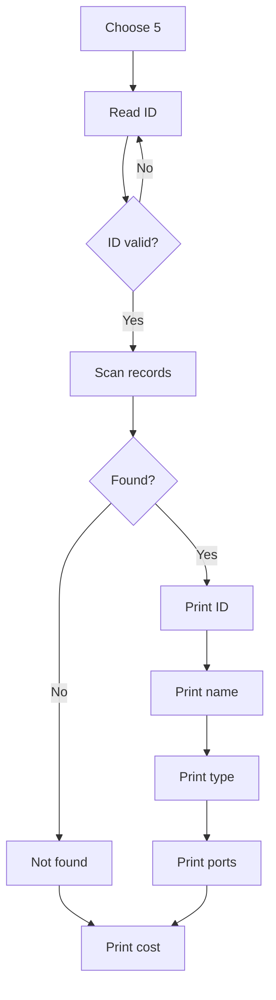

Search uses the unique **device ID**, not an array index. **Time O(V), space O(1)**.

## 6. Display network topology

**Input:** None.

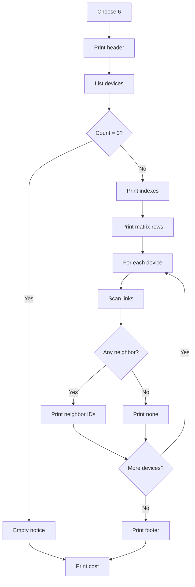

The displayed matrix uses **array indexes**; the adjacency list uses **device IDs**. An isolated device shows no neighbors. **Time O(V²), space O(1)**.

## 7. Breadth-first search (BFS)

**Input:** Starting ID, then whether to include disconnected components.

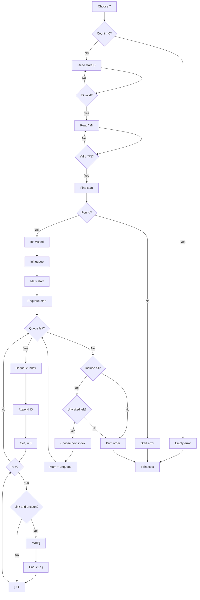

BFS visits a device, then its unvisited neighbors, using a **manually indexed queue** and a Boolean visited array. The queue stores indexes; the printed order uses IDs. With the **Y** option, remaining components are visited in ascending index order. **Time O(V²), space O(V)**.

## 8. Depth-first search (DFS)

**Input:** Starting ID, then whether to include disconnected components.

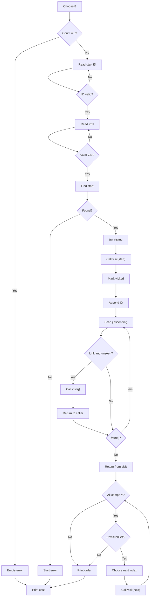

**Recursive detail:** Every `visit(i)` call marks `i` and appends its ID, scans neighbors in ascending index order, calls `visit(j)` for each linked/unvisited neighbor, and **resumes the caller's scan after that call returns**. When all neighbors are checked, the call returns. The diagram abbreviates the repeated recursive calls, but these steps run at every depth. If **Y** was selected, DFS starts again at each remaining unvisited index. **Time O(V²), space O(V)** including recursion.

## 9. Count devices

**Input:** None.

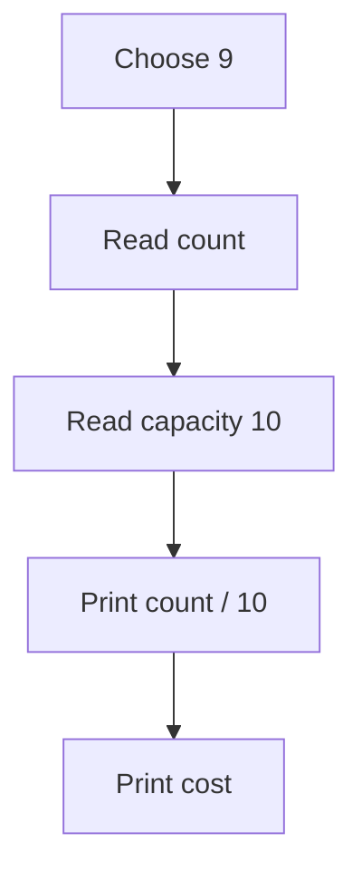

The graph maintains the counter when devices are added or removed, so counting is constant-time. **Time O(1), space O(1)**.

## 10. Check direct link

**Input:** Two IDs.

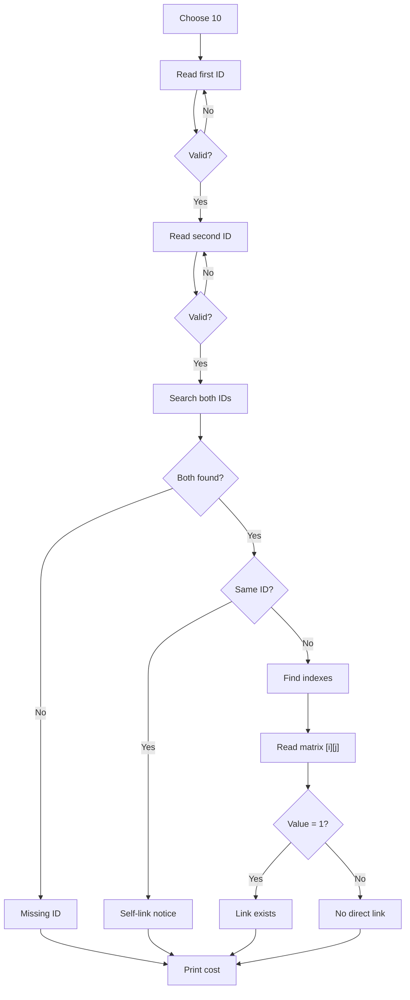

The check looks for **one edge**, not a multihop route. Searching the two IDs costs O(V); reading a matrix cell after the indexes are known is O(1). **Time O(V), space O(1)**.

---

[README](../README.md) · [Contributing](../CONTRIBUTING.md)
